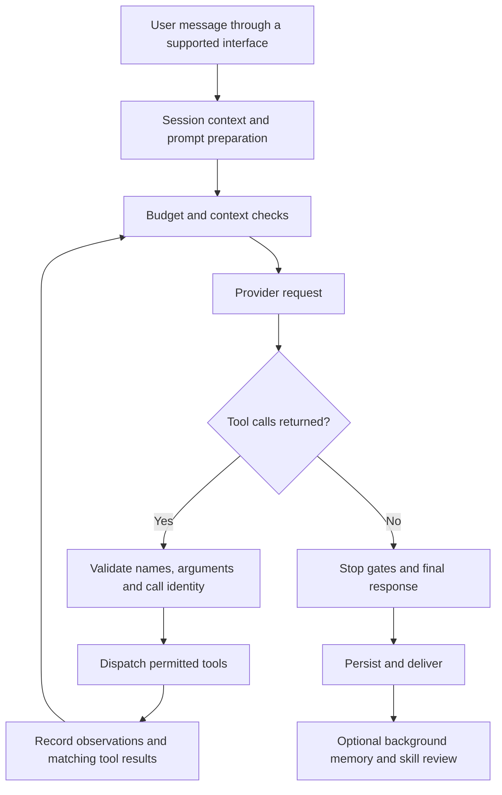

# Hermes Agent internals and what IRA should adopt

**Research date:** 17 October 2026 (Asia/Calcutta)
**Researcher:** Codex
**Status:** Source-backed research and integration recommendations. The new implementation design is awaiting user approval.
**User-selected first priority:** Reliable execution of existing IRA browser and desktop tasks, followed by memory and learning improvements.

## 1. Findings that change the implementation decision

Hermes is an agent runtime around an LLM. Its strongest transferable ideas are a small core tool surface, progressively loaded skills, bounded persistent memory, searchable conversation history, context compression, and separate background learning work.

Its normal self-improvement loop changes **stored instructions and memories**. It does not continuously train its underlying model weights. A better procedure can make the next attempt better without making the base model more intelligent. The repository also contains trajectory-generation/training utilities; those are a separate research capability, not evidence that an ordinary conversation fine-tunes the model. [H1, H5, H6]

Hermes's standard `SKILL.md` files are procedures the model reads and follows, sometimes with supporting scripts. They are **not** the typed `do:` / `check:` programs described in IRA's earlier specification. IRA already has the beginnings of that stricter format, and should complete it as an IRA-specific execution layer. [H4, I3]

The most urgent IRA problem is measurable: its worker currently regards a nonempty tool response as verification. A synthetic tool returning `Could not open app: simulated failure` produced `ExecutionResult(status='done', completed_steps=1, ...)`. Learning from that result would teach the system that failed work succeeded. Fix execution truth before building automatic learning on top of it. [I1, §10]

**Recommendation:** Retain Gemini Live and the Electron dashboard. Adapt Hermes's architecture inside IRA, beginning with a validated, observable execution service. Do not replace the voice runtime with Hermes or import its entire agent loop.

## 2. Scope, sources, and confidence

The primary research source is the user's extracted repository:

- Hermes: `C:\Users\kommi\Downloads\hermes-agent-main`
- Active IRA project: `C:\Users\kommi\VS code projects\IRA-LiveKit_Agent`
- Chat working directory: `C:\Users\kommi\VS code projects\livekit-voice-agent`, containing an older `ROADMAP.md` only.

The Hermes folder has no `.git` directory, so I cannot identify its upstream commit or establish that it matches the latest GitHub main branch. Selected source fingerprints appear in §16. The active IRA checkout has substantial existing tracked and untracked work; findings refer to the working tree, not only the last commit.

Method: inspect local implementation, compare repository documentation, trace the relevant call paths, inspect IRA's existing code and tests, run a harmless in-process worker probe, and run the focused parser/store/worker tests. I also read current official LiveKit tool/workflow documentation. No Hermes runtime, paid model call, real desktop action, or live voice test was used for this research. The report does not claim an exhaustive audit of every plugin or a measured Hermes-versus-IRA performance benchmark.

Source labels such as **H3** and **I2** resolve to local files in §15. Where source and prose documentation differ, implementation takes precedence. Proposed IRA behavior is explicitly marked as proposed.

## 3. Hermes's architecture

### 3.1 Shared core with multiple interfaces

Hermes exposes one agent core through several interfaces rather than implementing an independent brain in each UI.

| Layer | Main locations | Responsibility |
|---|---|---|
| Entry points | `cli.py`, `gateway/`, `acp_adapter/`, `batch_runner.py` | Accept interactive messages, platform events, editor requests, or batch tasks |
| Desktop/TUI interfaces | `apps/desktop/`, `tui_gateway/`, `ui-tui/`, `web/` | Present sessions and controls around backend services |
| Public agent facade | `run_agent.py`, `agent/agent_init.py` | Construct `AIAgent`, resolve configuration, expose conversation entry points |
| Turn orchestration | `agent/conversation_loop.py`, `agent/turn_*.py` | Prepare requests, call a model, handle tools, recover, stop, persist |
| Prompt construction | `agent/prompt_builder.py`, `agent/prompt_caching.py` | Compose identity, context files, skills index, memory, and provider caching hints |
| Tool runtime | `model_tools.py`, `tools/registry.py`, `agent/tool_executor.py` | Discover, advertise, authorize, dispatch, and record tool calls |
| Persistence | `hermes_state.py`, `hermes_state_*.py` | Store sessions/messages and their identities, search, usage, compression state |
| Memory and context | `tools/memory_tool_store.py`, `agent/memory_manager.py`, `agent/context_compressor.py` | Persistent facts, optional memory providers, active-context selection |
| Learning | `agent/background_review.py`, `agent/curator.py`, `tools/skill_usage.py`, `tools/skill_ledger.py` | Extract reusable lessons and maintain the skills library |
| Extensions | `plugins/`, `skills/`, `optional-skills/`, MCP tools | Add capabilities without continually expanding the core |

Many large subsystems use a public facade plus topic-specific sibling modules. Finding only `run_agent.py` or `hermes_state.py` is not enough to understand the implementation. The trade-off is more files and some late imports, in exchange for separable responsibilities. [H1, H2]

### 3.2 One turn through the system



This is a model-driven action/observation loop. The model selects the next action; the host owns execution and lifecycle. A natural-language plan alone does not perform any work.

The real loop includes interrupts, iteration/run budgets, rate-limit and provider-error handling, malformed/truncated response handling, context overflow recovery, partial results, and finalization. The default iteration budget exposed by the facade is large, and child work can share budget constraints. That demonstrates support for sustained tasks, not a sensible default cost budget for IRA. [H2, H9]

### 3.3 Why a small core matters

Tool definitions consume context and compete for the model's attention. Hermes keeps fundamental capabilities in a core set and routes other capabilities through toolsets, skills, plugins, and MCP.

Its tool-search layer can replace deferred tool definitions with `tool_search`, `tool_describe`, and `tool_call`. The model searches an index, obtains relevant schemas, and calls a concrete tool through the bridge. The catalog uses local lexical ranking, including BM25-related machinery, and a bounded listing. This reduces repeated schema payload, but search/describe calls can add latency. [H10]

For IRA, predictable frequent actions should remain easy to invoke. A generic discovery step before every simple voice command could make the assistant slower. Apply progressive disclosure primarily to growing skill libraries and specialist capabilities.

## 4. How Hermes improves across sessions

There are several distinct mechanisms. Calling all of them “self-learning” hides useful implementation differences.

### 4.1 Learning while doing work

The model can load a skill, use its procedure, and update it with a correction or reusable discovery through skill-management tools. It can also save a user preference or environment fact through the memory tool.

A skill is a directory containing `SKILL.md` with frontmatter and instructions, optionally accompanied by `scripts/`, `references/`, `templates/`, and assets. `skills_list` gives names/descriptions; `skill_view` supplies the skill document and a listing of linked files. Supporting files are fetched when needed. Hermes's current authoring standards call for descriptions of at most 60 characters and structured sections including prerequisites, procedure, pitfalls, and verification. [H4]

The resulting loop is:

1. Retrieve a relevant procedure.
2. Execute actions through tools and inspect their results.
3. Discover a correction, reusable technique, or preference.
4. Persist an improved procedure or fact.
5. Retrieve that improved material during later work.

This is persistent procedural knowledge. It still depends on the quality of observations and the model's judgment.

### 4.2 Background review after qualifying turns

The turn finalizer can start a separate review after the user-facing answer has been delivered. Eligibility depends on memory/skill review triggers, available tools, interruption state, and configuration. A skill creation nudge interval defaults to 10 iterations in the inspected initialization code; that is not equivalent to reviewing every tenth user message. [H5]

The review receives a conversation snapshot and asks whether useful skills or memories should be created or updated. It is distinct from the main task. Relevant details:

- The snapshot is isolated so review mutations do not rewrite the live conversation.
- The same-runtime route can reuse the parent's cached prompt; an explicitly routed different-model review can use a compact history digest.
- A dispatch-side whitelist limits the review's executable tools. Advertising a tool does not grant permission to execute it.
- Skill write guards track provenance and background read-before-write behavior.
- New foreground work can cancel/preempt background review through a cancellation handshake.
- Review input and iteration budgets bound work. The inspected input-budget default derives from 75% of the review model's context window, capped at 600,000 aggregate input tokens, with a 120,000 fallback for an unknown window. These are ceilings, not per-review usage estimates. [H5]

The review prompt emphasizes general rules, improving an existing skill rather than appending duplicate incident stories, and avoiding temporary failures as permanent constraints. “The browser was unconfigured today” should not become “never use browser tools.”

**Limit:** a review can draw a bad lesson. A usage counter or a model's proposed improvement is not proof that success rates increased. IRA should require outcome evidence and versioned evaluation before promoting automatically generated procedures.

### 4.3 Curator: maintain the library over time

The curator is library maintenance, not the same feature as post-turn learning. It handles inactivity-based lifecycle changes and optional model-assisted consolidation. [H6]

| Inspected source default | Value | Meaning |
|---|---|---|
| Enabled | `True` | Unless configuration disables it |
| Run interval | 168 hours | Seven days between eligible automatic passes |
| Minimum idle setting | 2 hours | Enforced by the entry point when an idle measurement is supplied |
| Stale age | 14 days | Eligible inactive skills can become stale |
| Archive age | 30 days | Eligible inactive skills can be archived |
| LLM consolidation | `False` | Opt-in; deterministic pruning does not require this model pass |
| Whole-tree backup retention default | 2 | Configurable retained snapshots |

The eligibility rules matter as much as the ages: pins protect skills from automatic transitions; agent provenance distinguishes curated material from external/hub content; protected skills remain protected. An optional built-in pruning setting changes the deterministic walk, not the general permissions of the LLM consolidation pass. Archived skills are recoverable.

The curator persists scheduling state, can produce Markdown/JSON reports, and reconciles relevant scheduled-job skill references when skills are consolidated. The code does not justify a claim that a model is always running after 30 minutes of inactivity.

### 4.4 Audit and rollback

`tools/skill_ledger.py` records mutations in a JSONL ledger, with before/after file manifests and content-addressed blobs. `agent/curator_backup.py` provides whole-library snapshots and rollback. In the inspected curator, the LLM consolidation pass earns a whole-tree snapshot; prune-only passes use recoverable archive operations rather than taking that snapshot on every pass. [H6, H7]

There is a practical distinction: ordinary ledger recording is best-effort telemetry; its failure does not generally block every write. Rollback has stronger capture requirements. Do not treat Hermes's ledger as a universal transactional guarantee.

### 4.5 “Learning made visible”

Hermes can display a graph containing learned/profile skills and memory entries. Declared related-skill metadata produces skill links; lexical overlap can produce memory-to-skill links. This is a useful explanation interface, not evidence of neural learning, causal understanding, or a mandatory graph database. IRA should first expose readable run history and version changes; a graph can come later. [H15]

## 5. Hermes memory: several stores with different jobs

| Memory layer | Contents | Access pattern | Trade-off |
|---|---|---|---|
| Active conversation | Recent user/assistant messages, observations, tool results | Passed to the current model | Rich detail, but consumes context |
| `MEMORY.md` | Durable environment facts, conventions, useful notes | Frozen prompt snapshot at session start | Small and immediately available |
| `USER.md` | Stable user preferences and profile | Frozen prompt snapshot at session start | Keeps personalization compact |
| Session database | Historical sessions/messages and metadata | On-demand `session_search` | Recover detail without loading all history |
| Skills library | Reusable procedures and supporting material | Catalog first, full skill when needed | Procedural memory that can grow independently |
| Optional external provider | Provider-specific user modeling/retrieval | Lifecycle hooks, recall, sync | More capabilities, with extra dependencies and possible cost |

### 5.1 Small persistent files

The built-in defaults are **2,200 characters for `MEMORY.md`** and **1,375 for `USER.md`**. These are character budgets, not exact token counts. Entries are separated by `\n§\n`. The store supports addition, patching/replacement, removal, and atomic operation batches. [H3]

When a tool write would exceed the final budget, the store returns an error and current entries so the model can consolidate or remove stale material and retry. It does not automatically summarize the overflowing file itself. Exact duplicate additions are avoided. Patch/remove operations identify entries and reject ambiguous or stale matches rather than silently selecting an arbitrary one.

Mutations use locking, a disk re-read, and atomic file replacement. The code includes drift detection for externally edited content and backup/refusal behavior to avoid overwriting data it cannot safely round-trip. Threat-pattern and invisible-character checks help with memory poisoning, although heuristic scans cannot guarantee that saved text is safe.

**Budget caveat:** externally written oversized memory can still be loaded with warnings. Tool-write limits do not prove that every manually edited file always fits the intended prompt budget.

### 5.2 The frozen snapshot pattern

At session start, the store loads memory and captures prompt blocks. A later `memory` call persists the new state, and its tool result exposes the live update. It does not rebuild the existing system prompt after every write. The next session loads the revised snapshot. [H3]

This protects the stable prompt prefix and prevents memory changes from continuously invalidating a cached conversation. Dynamic recall can be provided as appropriately framed contextual data instead of rewriting historical messages.

For IRA, preserve a stable, bounded startup context, but evaluate cache economics against **Gemini Live**, not Anthropic or OpenAI assumptions. Gemini's live session semantics are different from repeatedly submitting an ordinary chat-completions request.

### 5.3 Search old sessions instead of remembering everything in the prompt

The inspected `session_search` tool uses the SQLite session database and FTS5. Its argument shape determines the operation:

- Search/discovery with a query.
- Browse when no specific query/session is supplied.
- Read a session.
- Scroll around a message anchor.

It returns actual stored messages and does **not** call an LLM to summarize search hits in this snapshot. Discovery deduplicates session lineages and hydrates selected detail. Automation sessions can be demoted so repetitive cron text does not crowd out interactive conversations. Read responses have a per-message content cap (`2,000` characters in the inspected source); other modes have their own bounds. [H8]

This differs from the README's “FTS5 session search with LLM summarization” wording and from documentation saying there is no truncation. Those statements are not reliable descriptions of this local implementation.

Full-text search is lexical retrieval. It can miss a paraphrase with no shared terms; a vector/semantic provider may help later if measured recall failures justify it. A vector database is not a prerequisite for useful persistent memory.

### 5.4 External memory providers

`MemoryProvider` defines the extension contract. `MemoryManager` coordinates initialization, prompt blocks, prefetch/recall, synchronization, tool exposure, and shutdown hooks. The inspected built-in plugin directory includes providers such as ByteRover and RetainDB; the core contract describes one external provider selected by `memory.provider`. [H12]

The manager contains timeout, background synchronization, deduplication, and redaction logic. Session/profile identity must cross thread and process boundaries correctly. External-provider integration should never accidentally make one user's memory or credentials visible to another profile.

IRA already has SQLite FTS5, so introducing a hosted memory service immediately would add a second storage system before solving a demonstrated need.

## 6. Context optimization and compression

Persistent memory and context compression solve different problems. Persistent memory chooses what survives across sessions; compression controls what fits into a long active conversation.

### 6.1 The optimization stack

Hermes combines several measures:

1. Small persistent memory blocks.
2. Compact skill and deferred-tool catalogs.
3. On-demand full skill/tool/history retrieval.
4. Bounded and deduplicated tool output in relevant execution/context paths.
5. Prompt-prefix stability and provider-specific caching support.
6. Usage tracking and compression when necessary.
7. Separate context and budgets for delegated or background work.

These measures reduce irrelevant repeated input. No single one makes memory infinite, lossless, or free.

### 6.2 Default compressor

`ContextCompressor` implements the `ContextEngine` abstraction. The constructor's default threshold is 50% of resolved context length; configuration and model-specific logic can change effective behavior. A separate gateway hygiene layer is documented at 85%. These are distinct gates, not a requirement to compress twice. [H11]

The main algorithm prunes old tool-result content before paying for summarization, selects protected head and recent-tail regions, summarizes the compressible middle, and repairs message structure. User/assistant content and tool-call arguments are not casually treated as interchangeable with disposable old tool outputs. Pending call/result pairs and the current request must remain coherent.

Usage anchors prefer provider-reported token counts plus an estimate of newly appended content; whole-context estimates are fallbacks. Tail retention is more sophisticated than “always keep the last N lines.” The constructor also exposes head/tail settings, and token pressure influences boundary selection.

Summary generation runs through auxiliary model routing. Failure handling includes cooldowns, limited recovery paths, guards against ineffective repeated compression, and deterministic fallback modes. Some failures abort or stop rather than silently dropping history. Compaction is coordinated with durable session state and stale-attempt checks. [H11]

The summary is lossy. Important details may need to be recovered through stored history or artifacts. A plugin context engine can offer another strategy, but the existence of an interface or an `lcm` example in docs does not mean such a plugin is installed in this download.

### 6.3 What applies to IRA

IRA already passes a `ContextWindowCompressionConfig` containing a `SlidingWindow` to Gemini Live. That is provider-managed context-window behavior. There is no equivalent IRA-written executive-summary generator in the inspected function. Do not describe that configuration as a Hermes-style summarizer. [I2]

Recommended later memory work:

- Deduplicate the selected startup facts/preferences/notes by memory ID before formatting.
- Apply an aggregate character/token budget, not only three separate item-count limits.
- Keep exact detailed observations in a run/history store and return short evidence-linked results to the voice model.
- Retrieve relevant facts or prior runs only when needed.
- Preserve current task identity, inputs, cancellation state, and pending steps in durable structured state rather than hoping a conversation summary remembers them.
- Add an auxiliary summarizer only after measuring a gap the current Live API behavior and structured state do not cover.

No universal “2,000 characters for every tool” rule is recommended. Different outputs have different needs, and trimming away an error or identifier can make execution less reliable. Use per-tool bounded summaries plus an explicit path to fuller evidence.

## 7. How Hermes makes tool use more reliable

“Strict tool calling” contains at least four separate requirements: a valid request, permitted execution, a trustworthy observation, and proof that the intended outcome happened. JSON syntax covers only part of the first requirement.

### 7.1 Registration and availability

Tools register a name, schema, toolset, handler, and optional availability/timeout/result-size metadata. Definitions are selected for the session and provider. Registry checks reject some malformed registration shapes before they can poison every provider request. Availability checks and toolset membership are distinct from runtime authorization. [H9]

### 7.2 Call validation and recovery

`turn_tool_validation.py` normalizes call identities, checks names against the agent's available names, repairs certain name mismatches, validates JSON shape at this stage, handles malformed responses, and returns matching error results when recovery is possible. Truncated arguments can stop the turn rather than dispatching incomplete data. Repeated invalid names/arguments have bounded recovery behavior. [H9]

Unknown-name repair is a compatibility feature, not a behavior IRA should copy blindly for side effects. For desktop mutations, an unknown tool should be rejected unless it matches an explicitly registered alias; fuzzy renaming can select an unintended action.

The deferred `tool_call` bridge has local concrete-schema validation because its generic `arguments` object cannot express every underlying tool's contract. It checks required arguments and uses `jsonschema` when available, with schema-guided coercion. **It deliberately fails open in several cases**, including absent/malformed schema or unsupported validation conditions, and retains only reduced checking when the validator is unavailable. Hermes therefore is not uniformly strict/fail-closed on every dispatch path. [H10]

For IRA, known mutating tools should fail registration or invocation if their required validation cannot run. Validate types, enums, bounds, unknown keys, declared tools, and required inputs before executing.

### 7.3 Execute, observe, persist, return

The executor supports sequential and concurrent dispatch, interrupt/deadline handling, and a shared observation/commit/projection path. Call identities connect the model request, durable result, and UI events. Errors must remain distinguishable from success. [H9]

Concurrency is useful for independent reads. A single desktop or browser instance has shared mutable state: two commands that focus windows or click controls should not race. IRA should serialize that actuator even if unrelated reads run concurrently.

### 7.4 Stop gates help, but are not a universal verifier

Hermes has stop gates for configurable verification after code edits, plugin `pre_verify` hooks, and specific worker completion protocols. A proposed final answer can become interim output while the loop is nudged to continue. [H9]

These gates do not prove that arbitrary real-world tasks completed. They depend on the configured checks and workflow. Likewise, a UI card marked “tool finished” means the function returned; it is not proof that music is playing or that the intended document was saved.

### 7.5 An IRA execution contract that would be stronger

**Proposed, pending design approval:**

| Boundary | Required behavior |
|---|---|
| Request | Resolve exact skill/version and input values; ambiguous matches ask for clarification |
| Validation | Validate the entire executable plan before the first side effect; reject undeclared tools, missing inputs and invalid arguments |
| Ownership | Assign one run ID and a call/step identity; acquire the relevant desktop/browser execution lock |
| Preconditions | Confirm prerequisites using supported observations; prose is not automatically executable |
| Action | Dispatch a registered typed handler with a bounded deadline |
| Observation | Return structured success/error information and evidence references |
| Verification | Test the stated postcondition independently of the handler's friendly response text |
| Recovery | Retry only bounded, classified failures; inspect state before repeating an uncertain side effect |
| Cancellation | Stop admission of later steps; cooperate with in-flight operations; never describe an uninterruptible thread as already stopped |
| Completion | Publish success only after required step/final checks pass; otherwise preserve failed, cancelled, or uncertain state |

For example, “Play my playlist” should verify the selected playlist identity and observable playback state. A click on a Play button alone proves only that the click was attempted. IRA's current Spotify code also accepts `play-requested` as a successful outcome, so the verifier must distinguish an attempted action from confirmed playback. [I4]

A visual assertion such as `looks_like "music is playing"` remains probabilistic. Prefer DOM, app state, or API observations where possible. If a check lacks an implementation, refuse to call the plan verified; do not silently skip it.

LiveKit documents `ToolError` for tool failures, and background/async tool facilities for longer work. It also explicitly notes that speaking over a Python tool does not automatically cancel its work. Exact integration must be checked against IRA's installed SDK and Gemini path. [L1, L2, L3]

## 8. Other Hermes systems relevant to IRA

| System | What Hermes provides | IRA decision |
|---|---|---|
| Provider routing | Main model plus task-specific auxiliary routes and fallbacks | Keep IRA's existing realtime fallback; add a separately budgeted text model only when learning/research needs it |
| Delegation | Isolated child context, toolsets, limits, summaries and optional background execution | Useful later for open-ended work; excessive fan-out adds cost and coordination |
| Background processes | Process registry, polling/notifications and lifecycle management | Borrow ownership and cancellation concepts for long tasks |
| Scheduling | Cron jobs and delivery through supported surfaces | Separate future subsystem; IRA's current saved tasks are not automatically an execution scheduler |
| Session persistence | Stable identities, searchable messages, compression and lifecycle metadata | Start with a small run ledger and evidence store appropriate to IRA |
| Plugins/MCP | Extension seams rather than continually growing the core | Add only when a concrete capability needs one |
| Profiles | Scoped state/configuration/credentials across sessions and workers | Keep stores and run ownership explicit, even for a single-user app |
| Tool policy | Authorization hooks and environment/backend boundaries | Enforce policy in the execution service, not only in model instructions |
| Evaluation | Extensive behavior tests and specialized eval directories | Adopt failure-focused contract tests and real task success metrics |

Hermes's asynchronous delegation is described as process-local in its tool guide. Do not infer that every background agent survives restart. Persistence of a transcript, persistence of a task record, and safe resumption of a side effect are different guarantees. [H1, H9, H13]

## 9. IRA's actual starting point

| Area | Current working-tree evidence | Gap to address |
|---|---|---|
| Voice | Gemini Live native audio, model fallback, Kore voice | Preserve speech-to-speech and responsive interruption behavior |
| Tool surface | AST count found 33 `@function_tool` methods in `src/agent.py` | Organize routing without making frequent simple actions harder |
| Memory | SQLite, FTS5/BM25 with LIKE fallback, five categories, exact dedupe | Add explicit aggregate startup budgets, deduplication and memory provenance later |
| Startup recall | Up to 12 seed facts, recent event notes, up to 12 preferences | A preference can appear in both seed facts and the preference block |
| Workflows | Existing Markdown store, local matching and allowlisted execution path | Migration must retain old user files and distinguish preview from execution |
| New skill format | Parser, renderer, input substitution grammar, actions/checks and legacy conversion | Parsed prose/conditions do not yet constitute a running verifier |
| New skill store | `SkillStore.__getattr__` raises `NotImplementedError` | Implement versioned storage, lookup, migration and undo |
| Worker | Sequential calls with first-exception stop | Nonempty response is incorrectly treated as verification |
| “Powerful” worker | Inherits `LightweightWorker` without a new execution strategy | It is a placeholder boundary, not an autonomous reasoning agent |
| Tool errors | Several functions return apologetic strings | SDK lifecycle and worker may treat those as ordinary successful returns |
| Progress UI | Existing `ira.status` correlation and execution reducer | Extend the actual contract; preserve stale-event and call-identity handling |
| Bridge | `/token`, `/health`, and task CRUD | No implemented skills/history API in the inspected route table |
| Learning | Workflows can be saved and an adaptive-skill spec exists | No deployed end-to-end curator/learning pipeline in the inspected source |

Sources: [I1–I8].

The current `Skill` dataclass does not include every field shown in the older design's examples, notably its proposed top-level `allowed_tools`. Its parser can validate action names against a supplied `known_tools` set, but that does not enforce a per-skill capability grant. The new design must choose a concrete representation and test it, rather than assuming the example contract already exists. [I3]

## 10. Verification performed during research

### Synthetic false-success reproduction

I ran the real `LightweightWorker` with a one-step, in-memory workflow and a fake `open_app` handler returning:

```text
Could not open app: simulated failure
```

The observed sequence was `RUNNING → VERIFYING → DONE`, with:

```text
ExecutionResult(status='done', workflow='Research probe',
                completed_steps=1, total_steps=1,
                failed_step=None, message='')
```

The probe did not open an app or modify a workflow. The first attempt omitted the required `slug` constructor argument and did not run; the corrected probe produced the result above.

### Existing focused tests

Command run in the active IRA project:

```powershell
uv run --no-sync python -m pytest tests/test_skill_format.py tests/test_skill_store.py tests/test_workers.py -q --tb=short
```

**Result: 46 passed, 15 failed.** All 15 failures are skill-store calls reaching the existing `NotImplementedError` stub. The parser and existing worker tests passed. Passing worker tests do not cover the false-success condition demonstrated above.

The direct `uv run --no-sync pytest ...` entry point failed with `uv trampoline failed to canonicalize script path`; invoking pytest as a Python module worked. No environment repair or dependency update was needed for the investigation.

This was a focused baseline, not a full Python/frontend suite. Live voice, actual browser outcomes, external services, and cost/latency were not validated.

## 11. Corrections to the earlier IRA architecture document

The file `docs/superpowers/specs/2026-10-16-self-improving-adaptive-skills-architecture.md` is useful background, but its “approved” status and prose are not evidence that its features have been implemented. Several statements require correction before building from it. [I9]

| Earlier claim or implication | Source-backed correction |
|---|---|
| Hermes skills use deterministic `do:` / `check:` execution | That grammar belongs to IRA's proposed/parser design; Hermes's ordinary skills are loaded instructions |
| Curator means a model reviews after 30 minutes idle | Local defaults are a weekly interval and a two-hour idle setting when measured; LLM consolidation is opt-in |
| All learning happens through the curator | Post-turn background review is a separate mechanism |
| Session recall uses LLM summaries | The inspected session-search tool returns DB messages without LLM calls |
| Skills “strictness” can be achieved by MUST wording | Dispatch validation, result contracts and outcome checks must enforce it |
| Gemini context configuration summarizes old turns into executive bullets | IRA currently configures provider-side sliding-window compression |
| Memory preferences require a new `USER_PREFERENCES` table | Existing `memories.kind='preference'` already represents preferences |
| Current skill format already implements all proposed metadata | The actual dataclass/parser lacks some sample fields; schema work remains |
| A `/skills/{slug}/run` bridge endpoint can directly run the agent's desktop state | The bridge and agent are separate processes; command ownership/routing must be designed |
| A new `source: 'skill'` status payload can simply be emitted | Existing frontend types currently model lifecycle/tool sources; extend and test consumers together |
| Claude owns backend and Codex owns frontend | The user transferred both responsibilities to Codex on 17 October 2026 |

No earlier implementation or user data should be discarded simply because the accompanying design contains errors. Preserve the useful parser, migration tests, status correlation, and stores.

## 12. Integration approaches

| Approach | Advantages | Costs and risks | Recommendation |
|---|---|---|---|
| **A. Adapt Hermes patterns within IRA** | Reuses existing voice, browser, SQLite, parser and dashboard; incremental tests; no mandatory new service | We must implement and own the contracts | **Recommended** |
| B. Run Hermes as a separate task worker behind IRA | Rapid access to a broad tool/skill ecosystem | Second runtime, environment/dependency footprint, cross-process cancellation, separate memory and credentials, more model calls | Consider later for a specific open-ended task need |
| C. Replace IRA's core with Hermes and rebuild voice integration | Unified Hermes-centric behavior | Largest migration, uncertain native-audio fit, highest regression risk for current app | Poor fit for the selected priority |

Using Codex for this repository does not require IRA to call Codex or Claude at runtime. Keeping IRA's current Gemini integration is compatible with the selected approach. Whether a future auxiliary model has a free allowance or a paid bill depends on that provider/account; no free-inference guarantee is assumed.

## 13. Proposed adoption sequence

This is a research recommendation, not an approved implementation plan. Each phase has a clear purpose and can be evaluated independently.

### Phase 1 — Make existing tasks execute truthfully

**Candidate architecture:** Gemini Live remains the conversational controller. High-level skill calls enter one Python execution service. That service loads a versioned skill, validates all executable steps and inputs, serializes shared desktop/browser actions, checks postconditions, and publishes the same authoritative run outcome to voice and dashboard.

Complete the existing skill store and preserve legacy workflow originals/version history. Use a focused tool registry and verifier rather than expanding `agent.py` with another large execution loop. Treat plain-English skills as drafts until compiled/validated. Pin the skill version used by an active run so a later edit cannot change its remaining steps.

**Candidate components:**

- `src/skill_store.py`: persistent versions, lookup, legacy migration, hand-edit detection and undo.
- `src/skill_format.py`: finish the agreed machine-readable contract; preserve its useful parser/rendering work.
- A focused execution module plus tool/verifier interfaces: typed inputs/results, sequential step state, checks, deadlines, cancellation and bounded recovery.
- `src/agent.py`: thin tool adapters for run/stop/status and correctly signaled failures; reuse current browser/desktop services.
- `src/telemetry.py` and existing dashboard execution components: additive run/step status support with tested correlation.
- A minimal durable run record: IDs, pinned version, state, step outcome, timestamps and evidence references. Startup marks incomplete runs interrupted/uncertain; it does not blindly replay their side effects.

**Data flow:** voice or typed command → resolve skill → validate → acquire execution ownership → action → observation → check → persist outcome → update dashboard and speak a concise result. Existing UI commands continue through IRA; the Electron renderer does not implement desktop actions itself.

**Frontend boundary:** improve the current execution display and stop behavior first. A full Skills/Automation management page is a later phase. Persistent read APIs may be added through the authenticated loopback bridge when needed; execution commands must reach the agent-owned service rather than creating a competing browser in the bridge.

**Failure behavior:** reject malformed plans before side effects. Convert known operational failures into structured failure results and LiveKit `ToolError` at the appropriate adapter boundary. Do not parse English response text to infer success. A timeout with uncertain side effects stays uncertain until reconciliation. Retries are bounded and conditioned on whether repeating the action is safe.

**Acceptance evidence:** the false-success probe becomes a regression test; missing/invalid/undeclared tool calls perform no action; failed checks stop subsequent steps; cancellation prevents later steps and cannot be overwritten by a late success; duplicate delivery does not execute twice; edits do not mutate an active run's version; storage migration/undo preserve originals; the dashboard and voice agree on the terminal outcome. Real Windows/browser smoke checks then validate representative open-app, navigation and playlist tasks, alongside voice responsiveness.

### Phase 2 — Bound and improve memory

Reuse `MemoryStore`. Deduplicate startup facts/preferences, apply one context budget, add source/time/confidence or supersession metadata where useful, and support history recall separately from curated facts. A changed preference should supersede an old conflicting preference rather than silently accumulating both. Expose clear memory inspection/edit/delete behavior through IRA and a later management view.

Measure retrieval on actual questions: a remembered preference, a project fact from yesterday, a correction to an earlier fact, and a question whose answer was never stored. The last case must produce “not found,” not invented recall.

### Phase 3 — Learn from verified work

Start with explicit “remember this procedure” and corrective feedback, plus candidate suggestions after informative verified runs. A background compiler may propose a skill version from a redacted execution trace. Validate it through the same parser and registry, evaluate its checks, and only then make it eligible to run.

Separate `draft`, `validated`, and `enabled` states. Keep evidence, source run IDs, prior versions, and an undo path. Failed or uncertain runs can supply diagnostics, but must not be promoted as successful demonstrations. Skill changes must not grant new tool permissions or enable arbitrary shell execution by themselves.

Keep background model work disabled until a provider and budget are configured. Batch informative events, reuse stored evidence, and pause/preempt optional work when the user speaks. The first phase can work without this additional LLM loop.

### Phase 4 — Curator and management UI

Add usage/outcome statistics, stale candidates, pins, archival/restoration and reviewable consolidation. Implement readable skill version diffs and run history before a graph visualization. Distinguish “loaded” from “executed successfully”; Hermes's usage telemetry alone is not an outcome score.

Begin conservatively with suggested archival and recoverable changes. A later automatic policy can be based on actual usage patterns. Do not blindly apply 14/30-day cutoffs to rarely used but valuable IRA procedures.

### Phase 5 — Optional autonomous worker

Only if needed, add a separately budgeted model worker for new/open-ended tasks. It receives a scoped toolset and context and uses the same execution/result contracts. The voice agent stays available for steering. This phase is where a Hermes subprocess integration could be compared experimentally with a smaller IRA-native worker.

## 14. How to tell whether adoption helps

| Metric | What to record | Why it matters |
|---|---|---|
| Verified task success | Goal checks passed / attempted runs, by skill/version | Measures actual outcomes |
| False-success rate | Claimed successes contradicted by evidence | Directly targets today's bug |
| Invalid-call rate | Invalid names/arguments and retry count | Detects tool-selection/schema problems |
| Recovery quality | Transient recovery versus repeated uncertain mutations | Prevents retry loops from looking productive |
| Voice responsiveness | End-of-speech to first response; ability to steer during work | Protects IRA's defining interaction |
| Run latency | Per-step and total time | Reveals slow browser/check behavior |
| Memory quality | Relevant retrieval, contradictions, false recall | Tests usefulness rather than stored volume |
| Context/cost | Startup budget, input/output/cached tokens where exposed, background usage | Keeps optimizations economically meaningful |
| Learning quality | Candidate acceptance and success before/after a version change | Distinguishes improvement from more text |
| Cancellation integrity | No later action after acknowledged safe stop; uncertain actions disclosed | Verifies lifecycle truth |

Do not promise percentage savings or success improvements without a baseline. A smaller prompt can help, while additional retrieval rounds or background reviews can erase the saving.

## 15. Source index

The links below point to the inspected local files. They are useful for implementation follow-up and will move if the repositories move. Line anchors identify starting points, not permanent upstream revision links.

### Hermes

| ID | Source | Used for |
|---|---|---|
| H1 | [Root development guide](<C:/Users/kommi/Downloads/hermes-agent-main/AGENTS.md:1>), [README](<C:/Users/kommi/Downloads/hermes-agent-main/README.md:19>) | Architecture, caching intent, extensions, training-utility distinction |
| H2 | [Agent guide](<C:/Users/kommi/Downloads/hermes-agent-main/agent/AGENTS.md:1>), [conversation loop](<C:/Users/kommi/Downloads/hermes-agent-main/agent/conversation_loop.py:1>) | Turn phases, facade, budgets, lifecycle |
| H3 | [Memory store](<C:/Users/kommi/Downloads/hermes-agent-main/tools/memory_tool_store.py:175>), [memory tool](<C:/Users/kommi/Downloads/hermes-agent-main/tools/memory_tool.py:222>) | Character limits, frozen snapshot, atomic writes, batches |
| H4 | [Skills loader](<C:/Users/kommi/Downloads/hermes-agent-main/tools/skills_tool.py:1>), [skill authoring/curator guide](<C:/Users/kommi/Downloads/hermes-agent-main/skills/AGENTS.md:1>) | Progressive loading, file structure, standards |
| H5 | [Background review](<C:/Users/kommi/Downloads/hermes-agent-main/agent/background_review.py:1>), [review eligibility](<C:/Users/kommi/Downloads/hermes-agent-main/agent/turn_finalizer.py:762>), [initialization](<C:/Users/kommi/Downloads/hermes-agent-main/agent/agent_init.py:1387>) | Learning trigger, isolated fork, budgets, whitelist |
| H6 | [Curator](<C:/Users/kommi/Downloads/hermes-agent-main/agent/curator.py:1>), [backup/rollback](<C:/Users/kommi/Downloads/hermes-agent-main/agent/curator_backup.py:1>) | Defaults, transitions, optional consolidation, backup behavior |
| H7 | [Usage telemetry](<C:/Users/kommi/Downloads/hermes-agent-main/tools/skill_usage.py:1>), [mutation ledger](<C:/Users/kommi/Downloads/hermes-agent-main/tools/skill_ledger.py:1>) | Provenance, lifecycle, audit and rollback limits |
| H8 | [Session-search implementation](<C:/Users/kommi/Downloads/hermes-agent-main/tools/session_search_tool.py:1>), [session facade](<C:/Users/kommi/Downloads/hermes-agent-main/hermes_state.py:1>) | Search modes, actual-message recall, response caps |
| H9 | [Tool validation](<C:/Users/kommi/Downloads/hermes-agent-main/agent/turn_tool_validation.py:65>), [registry](<C:/Users/kommi/Downloads/hermes-agent-main/tools/registry.py:709>), [dispatcher](<C:/Users/kommi/Downloads/hermes-agent-main/model_tools.py:603>), [executor](<C:/Users/kommi/Downloads/hermes-agent-main/agent/tool_executor.py:1>), [stop gates](<C:/Users/kommi/Downloads/hermes-agent-main/agent/turn_stop_gates.py:1>) | Tool lifecycle and its guarantees/limits |
| H10 | [Tool search](<C:/Users/kommi/Downloads/hermes-agent-main/tools/tool_search.py:1>), [deferred argument validation](<C:/Users/kommi/Downloads/hermes-agent-main/tools/tool_search_validation.py:74>) | Progressive schemas and fail-open validation caveats |
| H11 | [Context engine](<C:/Users/kommi/Downloads/hermes-agent-main/agent/context_engine.py:1>), [compressor defaults](<C:/Users/kommi/Downloads/hermes-agent-main/agent/context_compressor.py:2812>), [compress operation](<C:/Users/kommi/Downloads/hermes-agent-main/agent/context_compressor.py:5528>), [compression/caching guide](<C:/Users/kommi/Downloads/hermes-agent-main/website/docs/developer-guide/context-compression-and-caching.md:1>) | Budgets, pruning, summaries, provider usage, recovery |
| H12 | [Memory-provider contract](<C:/Users/kommi/Downloads/hermes-agent-main/agent/memory_provider.py:1>), [memory manager](<C:/Users/kommi/Downloads/hermes-agent-main/agent/memory_manager.py:1>) | External provider lifecycle, retrieval/sync boundaries |
| H13 | [Tools/delegation guide](<C:/Users/kommi/Downloads/hermes-agent-main/tools/AGENTS.md:1>) | Toolsets, backend ownership, delegation and durability |
| H14 | [Prompt builder](<C:/Users/kommi/Downloads/hermes-agent-main/agent/prompt_builder.py:1>) | Prompt pieces, context files and skill index |
| H15 | [Learning graph](<C:/Users/kommi/Downloads/hermes-agent-main/agent/learning_graph.py:1>), [learning mutations](<C:/Users/kommi/Downloads/hermes-agent-main/agent/learning_mutations.py:1>) | Visible learning and user editing |
| H16 | [License](<C:/Users/kommi/Downloads/hermes-agent-main/LICENSE:1>) | MIT copyright/permission notice |

### IRA

| ID | Source | Used for |
|---|---|---|
| I1 | [Workers](<C:/Users/kommi/VS code projects/IRA-LiveKit_Agent/src/workers.py:1>) | Current execution, verification and placeholder worker |
| I2 | [Agent](<C:/Users/kommi/VS code projects/IRA-LiveKit_Agent/src/agent.py:106>), [workflow execution](<C:/Users/kommi/VS code projects/IRA-LiveKit_Agent/src/agent.py:888>) | Native compression, prompt assembly, tools and integration |
| I3 | [Skill parser](<C:/Users/kommi/VS code projects/IRA-LiveKit_Agent/src/skill_format.py:1>), [skill store stub](<C:/Users/kommi/VS code projects/IRA-LiveKit_Agent/src/skill_store.py:16>) | Actual versus planned skill contract |
| I4 | [Browser implementation](<C:/Users/kommi/VS code projects/IRA-LiveKit_Agent/src/browser.py:458>), [desktop primitives](<C:/Users/kommi/VS code projects/IRA-LiveKit_Agent/src/desktop.py:1>) | Existing tools and playback evidence |
| I5 | [Memory store](<C:/Users/kommi/VS code projects/IRA-LiveKit_Agent/src/memory.py:1>) | Existing FTS5, budgets, categories and ranking |
| I6 | [Status reporter](<C:/Users/kommi/VS code projects/IRA-LiveKit_Agent/src/telemetry.py:1>), [execution reducer](<C:/Users/kommi/VS code projects/IRA-LiveKit_Agent/dashboard/src/lib/execution.ts:1>) | Backend/frontend correlation contract |
| I7 | [Bridge routes](<C:/Users/kommi/VS code projects/IRA-LiveKit_Agent/src/bridge.py:283>), [handoff](<C:/Users/kommi/VS code projects/IRA-LiveKit_Agent/docs/handoff/HANDOFF.md:1>) | Process boundaries and existing architecture |
| I8 | [Store tests](<C:/Users/kommi/VS code projects/IRA-LiveKit_Agent/tests/test_skill_store.py:1>), [parser tests](<C:/Users/kommi/VS code projects/IRA-LiveKit_Agent/tests/test_skill_format.py:1>), [worker tests](<C:/Users/kommi/VS code projects/IRA-LiveKit_Agent/tests/test_workers.py:1>) | Focused baseline and unfinished contracts |
| I9 | [Earlier adaptive-skills specification](<C:/Users/kommi/VS code projects/IRA-LiveKit_Agent/docs/superpowers/specs/2026-10-16-self-improving-adaptive-skills-architecture.md:1>) | Prior design, with corrections in §11 |

### Current official LiveKit documentation

- **L1:** [Function tools and error handling](https://docs.livekit.io/agents/logic/tools/definition.md)
- **L2:** [Async tools and cancellation](https://docs.livekit.io/agents/logic/tools/async.md)
- **L3:** [Workflows, agents and tasks](https://docs.livekit.io/agents/build/workflows.md)

The installed LiveKit CLI reported version `2.13.2`, which does not expose the requested `lk docs` command. The Markdown documentation above was read directly. A CLI update is useful for later work; it was not required or performed for this report. Implementation must also inspect installed SDK behavior and run provider-specific tests rather than assume every current documentation feature is available unchanged.

## 16. Snapshot fingerprints and reuse

These SHA-256 hashes identify selected inspected Hermes files, not an upstream commit or a complete reproducible repository snapshot:

| File | SHA-256 |
|---|---|
| `agent/background_review.py` | `B177B1CFE8B06F9E787E37920FD9A7B023A038ECBAC951BDE4E81535D88AA4DC` |
| `agent/curator.py` | `FDE73780C9B72336B0D6E67FB984F9B1506C624037376902972A7C4D3D1E9A6B` |
| `agent/context_compressor.py` | `877DD1C110BBAF54B89BEAC6CE14580D9B7B2675425B167952FD532C07ABEA4C` |
| `agent/turn_tool_validation.py` | `CD5E412E4311BC12238F7774B084D5440C91E40710EAFDEAAC7C1BFA2DDB0AC4` |
| `tools/memory_tool_store.py` | `3280E2294928815AB2DD52479C5616AEE805E27819B901F9AF40831A293728C6` |
| `tools/session_search_tool.py` | `66DA7EF0383AA21A5A67F8803B8FA414842CEF4B1C532C6AE3CFA7996B893943` |
| `tools/tool_search_validation.py` | `E0A97B3ECC53A1E3FC4C9E8A5F88A211976B2E8BA808B81A6295273A04AD890C` |

Hermes's root license is MIT, copyright Nous Research. If implementation copies protected source rather than independently adapting architectural ideas, preserve the required copyright and permission notice. Individual bundled skills/assets may carry their own licenses. [H16]

**Next decision:** approve the Phase 1 architecture in §13, then finalize its specification and implementation plan through the requested brainstorming workflow. Research and baseline verification are complete; the proposed runtime changes have not yet been implemented.
