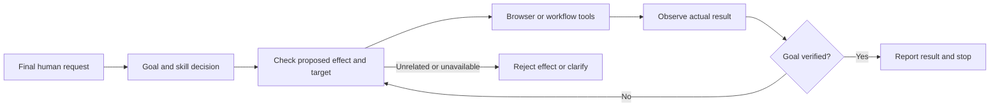

# IRA Skill Routing and Spotify Removal Implementation Plan

> **For agentic workers:** Use superpowers:subagent-driven-development or superpowers:executing-plans only when implementation is requested. The checkboxes below describe future work.

**Goal:** Remove IRA's Spotify automation and ensure that skill selection, workflow execution, recovery, and completion serve the current human request.

**Architecture:** Keep IRA's Gemini Live/LiveKit voice path and the existing procedural catalog, compiled workflow engine, request identities, host lock, and observations. Introduce one request-bound routing contract, enforce it at action admission, and give both skill modes the same eligibility and evidence rules. Use focused research tasks only where they reduce prompt and tool interference.

**Tech stack:** Existing Python/uv, LiveKit Agents, Gemini native audio, Playwright, SQLite, and Electron/React. No new framework or Spotify replacement is required.

**Spec:** The findings, removal scope, and routing design in this document form the proposed specification. This is a planning deliverable, not an approved or implemented patch.

**Date:** 20 November 2026, Asia/Calcutta.

## Scope and constraints

- The user requested investigation and planning only. No application code, skills, workflows, settings, or memory were changed during this investigation.
- The regression request is: **“Do a deep search about Microsoft.”** The user clarified that IRA opens Spotify while handling this research request.
- Actual application root: `C:/Users/kommi/VS code projects/IRA-LiveKit_Agent`. The current `livekit-voice-agent` workspace contains audit records and this plan.
- Preserve existing uncommitted application work. Reconcile any prepared repair before editing overlapping lines; do not apply an old patch blindly.
- Keep native audio in/out; do not introduce separate STT/TTS stages or replace IRA with another agent framework.
- Keep general Chrome/Brave browsing, browser profiles, desktop observations, host ownership, cancellation, permit expiry, and uncertain-effect replay prevention.
- Capability retirement concerns IRA's Spotify integration. It does not uninstall Spotify from Windows, change the user's account, erase browser profiles, or delete historical audit evidence.
- Each implementation task starts with a behavioral regression, demonstrates its failure, makes the smallest relevant change, and verifies the result. No implementation or live evaluation is part of this planning session.
- Once implementation/live evaluation is authorized, capture the pre-change build identity, settings, harmless contained request set, and available latency measurements before Task 1. Use isolated fixtures for requests known to drift; do not establish the baseline by repeating unwanted account actions on the personal desktop. If a comparable live baseline cannot be obtained, report that limitation rather than inventing one.
- Keep clarification answers and derived private text out of persisted history, events, errors, and learned source. Record slot names/provenance and redacted evidence; private bound values remain only in the active execution context where needed.

## What the investigation established

| Finding | Evidence | Implication |
| --- | --- | --- |
| Production Assistant defaults to a request scope without a judge. | [agent.py:604](</C:/Users/kommi/VS code projects/IRA-LiveKit_Agent/src/agent.py:604>); runtime construction at [agent.py:2427](</C:/Users/kommi/VS code projects/IRA-LiveKit_Agent/src/agent.py:2427>) supplies no alternative scope. | Request identity is checked, but relevance of the proposed effect to that request is not. |
| Absent or uninitialized semantic checking silently permits effects. | [request_scope.py:305](</C:/Users/kommi/VS code projects/IRA-LiveKit_Agent/src/request_scope.py:305>); [request_scope.py:609](</C:/Users/kommi/VS code projects/IRA-LiveKit_Agent/src/request_scope.py:609>). | Merely constructing `GeminiScopeJudge()` is insufficient: its missing-client path also allows execution. |
| An inert reproduction confirmed the bypass. | Nine admission-only probes against the current module, using “Search about Microsoft”; no permit was consumed and no tool executed. | Default and uninitialized modes each issued permits for Spotify playback, Spotify navigation, and an unrelated click. An injected denying judge rejected all three. This proves the bypass, not the accuracy of a real semantic model. |
| A recorded unrelated task actually selected Spotify. | [9 November bounded journal:116](</C:/Users/kommi/VS code projects/livekit-voice-agent/audit/2026-11-09/goal-evaluation-100651/eval_runs/20261109-162521-d1-folder-file-a1/evidence/journal.json:116>) and [journal:136](</C:/Users/kommi/VS code projects/livekit-voice-agent/audit/2026-11-09/goal-evaluation-100651/eval_runs/20261109-162521-d1-folder-file-a1/evidence/journal.json:136>). | A file-only request loaded `play-spotify`, then attempted playlist playback. The result reported ambiguity and no playback; do not describe this as verified music playing. |
| Folder requests also opened Spotify on 11 November. | [personal.sqlite3](</C:/Users/kommi/VS code projects/IRA-LiveKit_Agent/memories/personal.sqlite3>), journal seq566/570 → seq579; renewed folder request → seq590/592. | Dedicated tools and generic `open_app` are both paths for unrelated Spotify actions. |
| Captured Microsoft requests on 20 November do not show Spotify. | Same journal, seq603–608 at 15:03:55 UTC and seq609–614 at 15:04:32 UTC: Bing/Wikipedia navigation, page reads, summaries. | The user's exact deep-search playback incident has not been independently reproduced. These successful captured searches do not disprove an intermittent failure. |
| Procedural discovery does not assess task fit. | [skills.py:203](</C:/Users/kommi/VS code projects/IRA-LiveKit_Agent/src/skills.py:203>); [skill_tools.py:315](</C:/Users/kommi/VS code projects/IRA-LiveKit_Agent/src/skill_tools.py:315>). | The model chooses from a catalog; loading a procedure does not validate its goal, slots, or effect scope. |
| Procedure execution and mutation accept partial identifiers. | [skills.py:232](</C:/Users/kommi/VS code projects/IRA-LiveKit_Agent/src/skills.py:232>). | Unique substring lookup can silently select a procedure. It cannot itself turn “Microsoft” into “Spotify”; wrong upstream selection remains necessary. |
| Skill authoring is incorrectly treated as a read. | [request_scope_livekit.py:90](</C:/Users/kommi/VS code projects/IRA-LiveKit_Agent/src/request_scope_livekit.py:90>); bypasses at 453 and 462. | Create/edit/patch/delete/write/remove operations can bypass request admission. |
| The two skill modes have different lifecycle guarantees. | [skills.py:339](</C:/Users/kommi/VS code projects/IRA-LiveKit_Agent/src/skills.py:339>); [skill_bridge.py:29](</C:/Users/kommi/VS code projects/IRA-LiveKit_Agent/src/skill_bridge.py:29>); [skill_tools.py:550](</C:/Users/kommi/VS code projects/IRA-LiveKit_Agent/src/skill_tools.py:550>). | New procedures immediately become discoverable, the dashboard reports them ready with zero usage, and learning consumes only compiled-run evidence. |

**Root-cause conclusion:** The confirmed enabling defect is that current-request identity can be mistaken for permission to perform any available effect. Wrong skill or action proposals are not effectively rejected by the default runtime. Broad catalog exposure, retained conversation context, and operational memory increase opportunities for a wrong proposal, but the precise model trigger behind the reported deep-search incident is unproven.

The exact Microsoft/folder wording does not activate the action-word continuation filter in [execution_continuation.py:7](</C:/Users/kommi/VS code projects/IRA-LiveKit_Agent/src/execution_continuation.py:7>). Journals lack scope request/speech IDs, so incorrect generation binding is not established. Read-only inspection found no compiled workflow files and zero workflow/run rows in the current workflow databases; stale persisted compiled execution is not supported by this evidence.

The older October review's permissive outage fallback is no longer the current fallback: [request_scope.py:549](</C:/Users/kommi/VS code projects/IRA-LiveKit_Agent/src/request_scope.py:549>) permits only exact simple effects during an outage. The current defect bypasses that mechanism entirely. A prepared November repair in the separate evaluation worktree restores judge initialization; compare that implementation and its tests before recreating overlapping work. Its existence does not show that the current checkout is repaired.

## Recommended design and alternatives

| Approach | Benefit | Limitation | Decision |
| --- | --- | --- | --- |
| Delete Spotify and edit prompts only. | Small removal. | Generic tools can recreate the action; another unrelated skill can replace Spotify as the symptom. | Insufficient. |
| Restore relevance admission, retire Spotify, and add one shared routing contract over existing components. | Addresses the demonstrated execution gap and improves both skill modes with limited changes. | Requires explicit metadata, migration, and behavior tests. | Recommended. |
| Replace IRA's agent/workflow stack with a new framework. | Could provide a different orchestration model. | Large integration cost; does not automatically correct request scope or preserve voice latency. | Excluded from this plan. |

### One task-bound decision

Introduce a small routing unit in proposed `src/task_routing.py`. It consumes the finalized `RequestIdentity`, explicit clarification answers, available capabilities, and summaries from `SkillCatalog`/`SkillStore`. It returns a `TaskDecision` with:

- Original request ID, task kind, requested outcome, subject/target, and constraints.
- Mode: `direct_tool`, `procedure`, `workflow`, `clarify`, or `no_match`.
- Canonical selected identifier, version/document digest, and the input values with their human or observation provenance.
- Allowed tool names, effect types, target boundaries, and observable completion criteria.
- Reason for accepting, rejecting, or asking about a candidate.

A valid decision narrows the next action; it is never a blanket action permit. The proposed target and effect still pass through `RequestScopeTools` immediately before execution. Unknown or unavailable admission state must not return unconditional permission.

For **“Do a deep search about Microsoft”**:

1. Classify the goal as web research about Microsoft, not media or application playback.
2. Select a relevant web-research procedure or use ordinary browser tools if none exists. “Use all required tools” means only tools necessary for this goal.
3. Gather a bounded research brief: company/business overview, products, and recent public developments, with at least three actually read sources spanning primary Microsoft material and independent reporting. Verify freshness and cross-check significant claims; separate unresolved conflicts from confirmed facts.
4. Read pages and refine queries about Microsoft. Browser opening is a means to research, not completion. Saving a file, changing an account, sending a message, or launching Spotify is outside this request unless separately requested.
5. Return a researched summary with source evidence available to the dashboard and a concise spoken result. Do not promise exhaustive knowledge of Microsoft. Ask about a genuinely consequential scope ambiguity; do not require confirmation for ordinary research steps.

No relevant procedure means direct tools or a specific capability limitation. It never means “choose the closest skill.” Exact explicit names/aliases may identify candidates; category, shared words, popularity, old successes, or browser text cannot establish applicability. Execution and mutation require canonical identities; partial-name convenience belongs only in read-only search results.

### Minimal skill metadata

Extend existing procedural metadata with task kinds/applicability, exclusions, required input slots, allowed effects/tools, and done criteria. Honor `metadata.hermes.tags`, which current parsing ignores. Preserve Markdown as the human-readable procedure and existing compiled `do`/`check` structure.

Apply `draft → validated → enabled` eligibility to both modes. Legacy packages remain inspectable but need reviewed routing metadata before automatic selection. Edits change document identity and invalidate prior validation. An explicitly requested review can read a draft; loading it cannot authorize manual execution around its state gate.

Procedural packages cannot be passed unchanged into `SkillStore`: it parses flat compiled Markdown, whereas packages are nested `SKILL.md` documents with adaptive procedures. Add a small package state/history adapter in proposed `src/procedure_state.py`, using the existing SQLite infrastructure and separate procedure tables. Its interface is canonical package ID plus document digest. Task 3 establishes authoritative eligibility records; Task 5 adds immutable revisions and outcome history. This preserves both document formats and avoids a replacement execution engine.

Reuse compiled workflow preflight, exact phrase ambiguity handling, frozen inputs, question/run IDs, versions, and final checks. Adaptive procedures need durable outcomes tied to the same task, not just a `procedure_ready` message.

### Compact instructions and recovery

Use one shared operational policy for both prompt branches in `agent.py` and `context_instructions.py`; separate voice style from execution rules. Keep the policy explicit about the current goal, necessary steps, relevant candidates, missing inputs, observed outcomes, and stopping after completion.

Retrieve only relevant procedure summaries/bodies for the active task and refresh them after library changes. Keep the existing startup schema registration initially: IRA's current Gemini integration documents immutable tool schemas within a connection. Request-bound admission can narrow usable tools without assuming that calling `update_tools` is safe mid-session.

Fallback may change the execution method while preserving goal, target, request ID, and allowed effects. A browser error may justify fresh desktop observation/input to the same requested page. A scope rejection, retired capability, cancellation, or uncertain effect must not be swallowed by broad exception handling and converted into a system-browser/app launch.

For more complex research, a focused LiveKit task with a scoped context is an incremental next step. Measure its behavior and latency before adopting it broadly. Current official [workflow guidance](https://docs.livekit.io/agents/logic/workflows.md) and [supervisor guidance](https://docs.livekit.io/agents/logic/patterns/supervisor.md) support this incremental approach. The installed `lk` is 2.13.2 and lacks `lk docs`; official Markdown pages were read directly. No CLI upgrade was performed.

## Complete Spotify removal inventory

| Action | Files/surfaces | Required result |
| --- | --- | --- |
| Delete dedicated runtime. | `src/spotify_tools.py`, `src/spotify_browser.py`, `src/spotify_dom.py`. | Four voice tools and player logic disappear. |
| Remove automatic registration and generic coupling. | [agent.py:55](</C:/Users/kommi/VS code projects/IRA-LiveKit_Agent/src/agent.py:55>), superclass at 486; navigation branches at 1299/1417; [browser.py:17](</C:/Users/kommi/VS code projects/IRA-LiveKit_Agent/src/browser.py:17>), superclass at 319, dedicated opening method at 484. | Removing a mixin must not leave calls to its missing helper methods. Ordinary browsing continues. |
| Delete bundled procedure. | `skills/media/play-spotify/` including `SKILL.md` and any package support files. | No discovery result, selected procedure, or prompt catalog advertises Spotify playback. |
| Remove compiled adapters and aliases. | [skill_adapters.py:292](</C:/Users/kommi/VS code projects/IRA-LiveKit_Agent/src/skill_adapters.py:292>), validators/methods; legacy whitelist in `src/skills.py`; music aliases in `src/tool_dispatch.py`; playlist compatibility in `src/skill_execution.py`. | Three compiled adapter entries and exclusively music-specific compatibility disappear; keep aliases used by remaining tools. |
| Clean current prompts/examples. | `src/agent.py`, `src/context_instructions.py`, `src/request_scope.py`, `src/execution_continuation.py`, `src/skill_format.py`, `src/tool_mastery.py`, `skills/desktop/open-desktop-app/SKILL.md`, `scenarios.yaml`. | Remove capability/control instructions and music-only continuation. Replace unrelated examples with Calculator or a neutral web page. |
| Retire operating memories. | [MEMORY.md:5](</C:/Users/kommi/VS code projects/IRA-LiveKit_Agent/memories/MEMORY.md:5>), operating recipes in [USER.md:13](</C:/Users/kommi/VS code projects/IRA-LiveKit_Agent/memories/USER.md:13>), canonical profile's Spotify/browser routing clause. | No active memory re-advertises the capability or directs playback. Preserve unrelated profile content and personal music facts as inert data. |
| Migrate saved workflows where present. | `workflows/`, `.skills.sqlite3`, `.runs.sqlite3`, configured alternate stores. Current inspected stores contain zero workflows/runs. | Scan canonical tool names and semantic Spotify recipes, including generic browser/desktop steps. Retire relevant active records with recoverable version history. Do not erase the whole workflow library or database. |
| Clean product docs, configuration, and labels. | `.env.example`, `README.md`, `dashboard/src/lib/execution.ts`, Spotify fixtures in dashboard tests. | Remove four action labels, setup instructions, and obsolete service preference/environment references. No Spotify-specific package dependency was found. |
| Retire dedicated test drivers. | `scripts/evaluate_spotify_playback.py`, `scripts/inspect_spotify_player.py`, `tests/test_spotify_browser_eval.py`, `tests/test_spotify_live_eval.py`, `tests/test_spotify_target_revalidation.py`. | Delete these active drivers; update mixed generic tests by removing only Spotify cases/fixtures. Retain removal regressions. |

Keep historical research reports, logs, and journal evidence. Existing history may mention Spotify, but current capability availability and task admission must outrank that history. Do not implement retirement by deleting every textual occurrence from the repository.

Retirement must also cover generic playback substitutes: `open_app("Spotify")`, `spotify:` launch URLs, player navigation for playback, selecting an old player tab, clicking Play, media keys, and authored procedures using generic steps. Check the resolved app/page/control and current task at the shared admission boundary. Read-only research about Spotify as a company remains ordinary research; an unavailable playback request returns a clear unsupported result without opening a substitute browser/app.

Shared Brave/browser behavior and audio/DRM settings are not demonstrated incident causes. Keep them initially; use observed autoplay or profile issues to justify a separate change.

## Ordered implementation tasks

### Task 1 — Restore task-relevance admission

**Files:** `src/request_scope.py`, `src/request_scope_livekit.py`, `src/agent.py`; tests `test_request_scope.py`, `test_request_scope_boundaries.py`, `test_request_scope_livekit.py`, and `test_request_scope_integration.py`.

**Consumes:** Existing request identity, proposed action, resolved target observation, request history, and initialized/injected judge.

**Produces:** Every exported effect is either assessed against the current goal or receives a bounded unsupported/policy-unavailable result. Read operations remain distinguishable from mutations.

- [ ] Add a failing regression through actual exported tool wrappers: bind the deep-Microsoft request, propose unrelated Spotify/app/navigation/input effects using inert fakes, and assert zero fake effects.
- [ ] Exercise missing judge, missing client/key, malformed policy result, quota, timeout, observation-only requests, and stale/cancelled generation. Require safe exact-command fallback where it can establish the requested action; do not fall through to unconditional allow.
- [ ] Compare the prepared November request-scope repair and port only applicable changes into the current source. Remove both absent-judge and absent-client permission bypasses, initialize the production judge correctly, and close an owned client during shutdown.
- [ ] Remove `skill_manage` from local reads or split true reads from authoring operations; bind and assess mutations before any filesystem write.
- [ ] Retain single-use permits, fingerprint checks, host-boundary rechecks, budget, and cancellation. Validate exact targets rather than treating an arbitrary click/browser launch as inherently related.
- [ ] Run the focused scope tests with `uv run pytest tests/test_request_scope.py tests/test_request_scope_boundaries.py tests/test_request_scope_livekit.py tests/test_request_scope_integration.py`. Use fake policy/host effects; a real provider evaluation belongs to Task 6.
- [ ] Review and commit only this task's changes. Gate: unrelated proposals issue no executable permit and invoke no host effect; legitimate exact commands still work.

### Task 2 — Retire Spotify across all execution paths

**Files:** All active surfaces in the inventory, plus `tests/test_agent.py`, `tests/test_capability_loading.py`, `tests/test_hermes_execution_repair.py`, `tests/test_browser_and_memory.py`, `tests/test_execution_continuation.py`, `tests/test_tool_dispatch.py`, and dashboard `execution.test.ts`/`Skills.test.tsx`.

**Consumes:** Task 1's enforced action admission and the current capability registry.

**Produces:** Spotify automation is unavailable through dedicated tools, catalogs, old recipes, and generic fallback.

- [ ] Before removal, add failing absence checks against actual registered SDK tools, compiled registry, both rendered prompt paths, and catalog. Add generic-path tests for `open_app`, player navigation, old tab/control targets, and old procedure text.
- [ ] Delete the dedicated implementation/package/drivers; remove imports, superclass references, helper branches, adapters, and exclusive aliases without restructuring shared browser code.
- [ ] Apply targeted operational-memory changes through existing memory APIs/version checks so a concurrent profile update is not lost. Confirm history cannot revive retired capability claims during reset or context restore.
- [ ] Scan actual configured stores; archive/disable any Spotify recipe and invalidate pending plans/permits referring to it. Current empty stores require no invented workflow deletion.
- [ ] Make unknown retired tool calls and generic playback substitutes return unsupported without browser/app fallback. Ensure `skill_adapters.browse_to` rethrows scope/cancellation/unavailable errors before its broad fallback.
- [ ] Update docs/scenarios/mixed fixtures and four dashboard labels. Test ordinary Brave navigation, tabs, page reads, and neutral app launch positively.
- [ ] Run `uv run pytest tests/test_agent.py tests/test_capability_loading.py tests/test_hermes_execution_repair.py tests/test_browser_and_memory.py tests/test_execution_continuation.py tests/test_tool_dispatch.py` with live eval flags unset; in `dashboard`, run `npm test -- src/lib/execution.test.ts src/components/Skills.test.tsx` and `npm run typecheck`.
- [ ] Review and commit. Gate: zero Spotify actions through either tool mode or generic fallback; ordinary web research and app control pass.

### Task 3 — Add precise skill selection and input binding

**Files:** Proposed `src/task_routing.py`, `src/procedure_state.py`, `tests/test_task_routing.py`, and `tests/test_procedure_state.py`; modify `src/skills.py`, `src/skill_tools.py`, `src/skill_format.py`, `src/request_scope_livekit.py`; existing skill/store/clarification tests.

**Consumes:** Task 1 action enforcement, Task 2 capability availability, finalized human input, procedural/compiled summaries.

**Produces:** The `TaskDecision` contract defined above, exact canonical selection, validated slots, and bounded abstention.

- [ ] Add table-based failing cases: deep Microsoft research, no matching skill, conflicting candidates, exact explicit names, partial names, duplicate names across categories, unsupported/draft/archived packages, missing slots, and nested metadata tags.
- [ ] Extend metadata parsing with applicability/exclusions/input/effect/done fields; correct nested tag handling. Keep legacy packages readable while excluding unreviewed entries from automatic action selection.
- [ ] Establish the minimal procedure eligibility adapter keyed by canonical package ID and digest, with `draft`, `validated`, and `enabled` states. Authoring always creates a draft; file content cannot self-enable a package. Explicit enablement validates the current digest and routing metadata. This gate must exist before Task 4 introduces the reviewed research procedure.
- [ ] Implement one decision helper over existing catalogs. Accept only compatible goals/targets/effects; return direct tools, clarification, or no-match for other cases. Use deterministic exact identifiers and schema checks first; use model judgment only for semantic cases the structured contract cannot resolve.
- [ ] Require canonical identity and current document digest for execution and mutation. If a package changes between selection and invocation, re-resolve/revalidate rather than execute the old approval against new contents.
- [ ] Bind input values to the human request/explicit answer or a legitimate observed fact. Reject unknown/conflicting inputs and content/target replacement by generic aliases. Never populate missing values from a previous playlist/task.
- [ ] Use existing `clarify_request` and question/run lineage for genuine ambiguity. A research subject already named Microsoft requires no extra confirmation.
- [ ] Run `uv run pytest tests/test_task_routing.py tests/test_procedure_state.py tests/test_skills.py tests/test_skill_store.py tests/test_skill_clarification.py tests/test_skill_clarification_tools.py tests/test_tool_dispatch_boundary.py`.
- [ ] Review and commit. Gate: every accepted skill has a stated task fit and frozen identity; no-match does not select an unrelated package.

### Task 4 — Make research and workflow recovery follow the same goal

**Files:** `src/agent.py`, `src/context_instructions.py`, `src/skill_tools.py`, `src/execution_continuation.py`, `src/skill_adapters.py`, `src/skill_execution.py`; proposed `skills/web/research-topic/SKILL.md`; prompt, continuation, workflow, browser, and routing tests.

**Consumes:** Accepted `TaskDecision`, validated slots, existing observations, registry and final checks.

**Produces:** A bounded research procedure, consistent operational prompts, and method changes that preserve goal/target/effect boundaries.

- [ ] Add failing end-to-end fake-page cases for deep Microsoft research: relevant searches/reads, multiple sources, evidence-backed output, and no Spotify/app/file/message effects. Include incomplete page results and conflicting claims.
- [ ] Create a reviewed research procedure with required subject, intended depth, permitted browser reads/search navigation, source records, and observable done criteria. No default unrelated destination or task.
- [ ] Consolidate shared execution/routing policy across both prompt branches, while retaining IRA's voice style. Retrieve task-relevant summaries and refresh candidate context on `skills.changed`.
- [ ] Preserve startup schema registration; enforce per-task use through admission. Prototype a scoped LiveKit research task only if the simpler procedure still exposes measurable context interference.
- [ ] Replace action-word-only recovery decisions with accepted task state and remaining steps. Keep at most one no-action nudge; stop nonretryable rejections, uncertainty, cancellation, and unsupported capability. Fresh observation may resolve uncertainty before a genuinely new action.
- [ ] Require verified final objective, not loaded instructions, a browser-open return, or merely sent input. A blocker remains an explicit blocked/unfinished outcome.
- [ ] Run `uv run pytest tests/test_context_instructions.py tests/test_execution_continuation.py tests/test_skill_execution.py tests/test_skill_observations.py tests/test_verified_actions.py tests/test_task_routing.py`.
- [ ] Review and commit. Gate: successful research carries read-source evidence; recovery cannot change task or reactivate a retired capability.

### Task 5 — Align procedure lifecycle, run evidence, and learning

**Files:** `src/procedure_state.py`, `src/skills.py`, `src/skill_store.py`, `src/skill_runs.py`, `src/skill_tools.py`, `src/skill_learning.py`, `src/skill_bridge.py`, `src/session_memory.py`; dashboard `shared/types.ts`, `components/Skills.tsx`, `lib/execution.ts`; lifecycle, bridge, memory, and dashboard tests.

**Consumes:** Frozen canonical decisions, request IDs, actual tool results, and completion evidence from Tasks 1–4.

**Produces:** Both procedure modes have reviewed eligibility and honest persisted outcomes; learning can consume verified adaptive runs.

- [ ] Add failing cases showing that newly authored/edited procedures cannot immediately become eligible, loading does not count as execution, and failed/uncertain/off-goal work cannot be learned.
- [ ] Extend Task 3's package-state adapter with immutable document revisions and archive/restore behavior, following existing compiled lifecycle rules without parsing adaptive packages as compiled skills. Preserve recoverable revisions; importing an old package does not silently enable it.
- [ ] Extend run records to adaptive procedures with mode, request ID, decision/document digest, step/action IDs, input names/provenance, redacted observations, final criteria, and terminal status. Do not persist clarification answers or derived private input values. Record usage only when work starts and success only when its requested result is verified.
- [ ] Map existing statuses consistently across backend, journal, and dashboard: `procedure_ready` means loaded; running/waiting stay active; done means verified; error/cancelled/uncertain never appear completed.
- [ ] Bind learning to verified original-task evidence, preserve parameterized source, and save learned work as a draft. Do not enable it or copy old literal targets automatically.
- [ ] Make the dashboard show actual mode/state, current goal, selection reason, step/blocker, and outcomes. Distinguish changing eligibility from running a procedure.
- [ ] Run `uv run pytest tests/test_procedure_state.py tests/test_skills.py tests/test_skill_store.py tests/test_skill_runs.py tests/test_skill_learning.py tests/test_skill_clarification.py tests/test_bridge_skills.py tests/test_bridge_procedures.py tests/test_session_memory.py`; run relevant Skills/execution Vitest tests and `npm run typecheck` in `dashboard`.
- [ ] Review and commit. Gate: a loaded procedure is never presented or learned as a completed task; lifecycle changes cannot bypass current-request scope.

### Task 6 — Verify the assembled behavior and release evidence

**Files:** `scenarios.yaml`, existing evaluation harness and tests, a new dated evaluation report under `docs/research/` in the application project.

**Consumes:** Tasks 1–5 and their independently passing behavioral checks.

**Produces:** Evidence for removal, relevant routing, accurate completion, and voice responsiveness on the assembled application.

- [ ] Run appropriate offline suites first with inert host/model fakes; then `uv run ruff check` on changed Python files, full `uv run pytest`, dashboard `npm test`, `npm run typecheck`, and `npm run build`. Diagnose pre-existing unrelated failures separately; do not claim they were caused or repaired by this plan.
- [ ] Add simulation scenarios for deep Microsoft research, the same request after historical Spotify context, a folder request after research, no relevant skill, observation only, stop during execution, and a retired Spotify playback request.
- [ ] After implementation is requested, use a contained test browser/desktop profile and actual runtime build identity for live checks. Start with typed trials; exercise voice after the deterministic cases succeed.
- [ ] Use three independent trials for each critical request and repeat the deep-search case in a continuing session with older music context. Record utterance/transcript, request/speech/run/decision IDs, selected skill, proposed target, admission outcome, actual tool result, and verified final artifact/source. Protect unrelated personal content.
- [ ] Verify absent Spotify tools/catalog/prompts/operating recipes and zero Spotify effects from dedicated or generic paths. Test read-only company research separately from unavailable playback.
- [ ] Measure time to first meaningful response, first useful action, and verified completion. Compare median and p95 to the pre-change baseline, recording real semantic-policy overhead; do not invent a latency target or silently disable relevance checks to improve speed.
- [ ] Publish an evidence report describing the precise tested build, pass/fail outcomes, unresolved cases, and latency. Gate: zero off-goal effects in the tested cases, research criteria met, honest terminal state, and preserved voice path. Three passes are a release check, not proof that intermittent failures are impossible.

## Other IRA improvement areas, after the routing fix

| Priority | Area | Concrete improvement and proof |
| --- | --- | --- |
| First | Browser/desktop reliability | Bind every interaction to the actual page/window/control and fresh observation. Prove the target cannot drift after focus/tab changes. |
| First | Completion honesty | Separate launch/input delivery from observed outcome; verify requested app, file content, task time, or research evidence before success. Existing November evaluations expose false launch claims. |
| Next | Research quality | Retain source URLs, dates, extracted facts, conflicting evidence, and requested depth. Evaluate against fixed pages before open-web scoring. |
| Next | Memory/context | Keep personal facts separate from executable instructions and unfinished-task authority; invalidate stale capability claims. Test reconnect, summary restore, correction, and task switching. |
| Next | Time and tasks | Bind relative dates to current Asia/Calcutta time and confirm persisted timezone-aware deadlines. Reuse the prepared November deadline repair where applicable. |
| Next | Written versus spoken output | Apply brief plain-text restrictions to speech, while allowing requested structured/written dashboard output. Add JSON/file-output behavior tests before changing prompts; the prior evaluation recorded refusals. |
| Later | Complex/background work | Keep conversational control with IRA while a scoped worker handles slow research; retain request lineage, cancellation, and verified return results. Measure benefit before introducing a general job framework. |
| Later | Tool breadth and voice latency | Narrow candidate context and measured per-task tool exposure. Add a small execution facade only if current schema/prompt cost is demonstrated; do not rebuild the stack speculatively. |

## Acceptance checklist for the user's goal

- [ ] Spotify runtime, procedural package, compiled adapters, active prompts, operating memories, UI labels, and dedicated drivers are retired.
- [ ] Old instructions cannot recreate Spotify actions through generic browser/desktop/app tools.
- [ ] Deep Microsoft research selects relevant research work or direct web tools, with source evidence and no unrelated effects.
- [ ] Missing/ambiguous candidates lead to abstention or a necessary clarification, not a random/default skill.
- [ ] Default, uninitialized, outage, stale, cancelled, and uncertain execution paths preserve the task boundary.
- [ ] Both skill modes use reviewed eligibility, frozen identity, verified outcomes, and draft learning.
- [ ] Existing voice, browser, desktop, and memory contracts are validated in the tested build.

**Planning result:** The investigation and proposed design are complete. Application behavior remains unchanged until this plan is implemented and tested.
