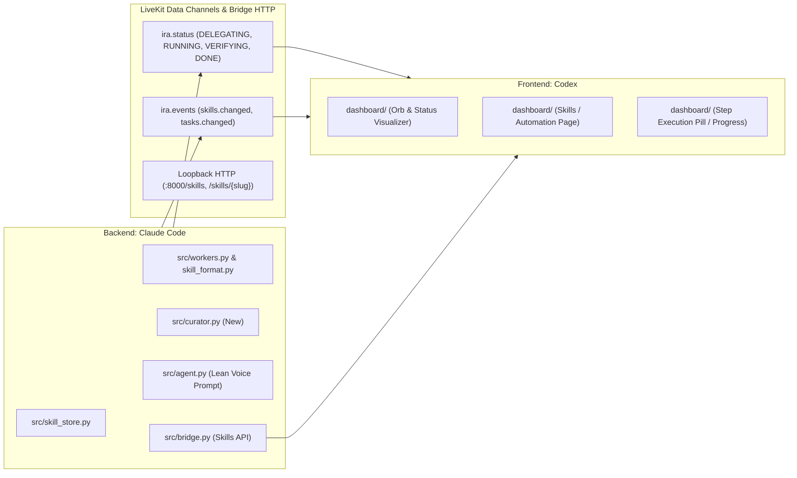
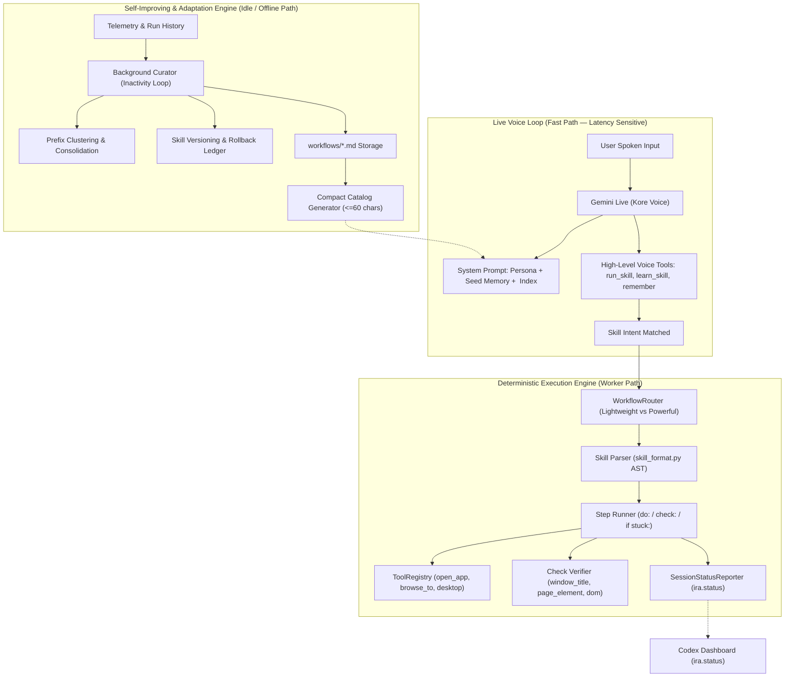
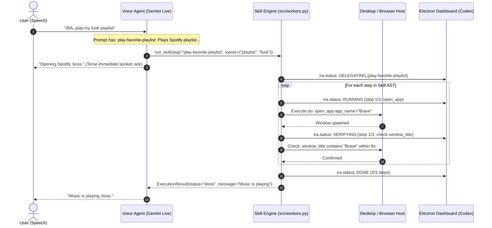
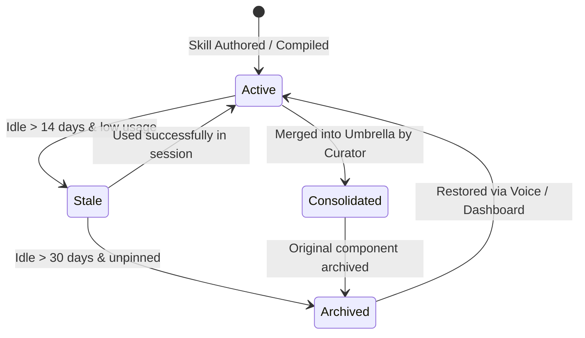

# Architectural Specification: Self-Improving, Adaptive, and Strict Skill Engine for IRA
**Author / Research Source:** Antigravity AI Engine (via deep inspection of Hermes Agent and IRA-LiveKit-Agent)
**Target Developers:** Claude Code (Backend Owner) & Codex (Frontend Owner)
**Date:** 2026-10-16
**Status:** Approved Architectural Spec & Implementation Plan
**Context:** Multi-agent development aligned with [`docs/handoff/COORDINATION.md`](../handoff/COORDINATION.md)

---

## 1. Executive Summary & Foundational Invariants

### 1.1 The Core Challenge
IRA is a true real-time speech-to-speech assistant powered by Gemini Live (`gemini-3.8-live` or native fallback). Her defining quality is natural conversation and immediate response latency.
However, she currently suffers from **monolithic tool creep**:
- Over 30 `@function_tool` methods are mounted directly on `Assistant` in `src/agent.py`.
- Complex multi-step actions (web navigation, Spotify playback, desktop automation) are left to model improvisation during voice streaming, leading to nondeterministic execution, hallucinated steps, or dead air.
- [`src/skill_store.py`](file:///C:/Users/kommi/VS%20code%20projects/IRA-LiveKit_Agent/src/skill_store.py) is currently an unfulfilled stub raising `NotImplementedError`.
- No automated mechanism exists to learn from execution failures, distill new reusable capabilities, or clean up obsolete procedures.

### 1.2 Lessons from Hermes Agent
From deep inspection of the [Hermes Agent codebase](file:///c:/Users/kommi/Downloads/hermes-agent-main), three architectural invariants solve these exact problems:
1. **The Core is a Narrow Waist; Capability Lives at the Edges**: Keep the primary system prompt and toolset minimal. Never send 30 tools on every voice turn. Present a lightweight catalog of capabilities and fetch full details only on demand.
2. **Deterministic Step Execution over Free-form Improvisation**: Skills are structured Markdown files with executable `do:` actions and tangible `check:` conditions. An execution worker, not the LLM, drives the sequence.
3. **Background Inactivity Curation (`Curator`)**: Self-improvement, skill consolidation, and garbage collection happen in background/idle loops using auxiliary agents, never blocking the live conversational loop.

---

## 2. Division of Ownership (Claude & Codex Contract)

As defined in [`docs/handoff/COORDINATION.md`](../handoff/COORDINATION.md):



### 2.1 Claude's Responsibilities (Backend)
- Implement `src/skill_store.py` backed by `src/skill_format.py`.
- Strip operational micro-tools off `Assistant` in `src/agent.py`; replace them with a slim `<available_skills>` catalog and router tools (`run_skill`, `list_skills`, `learn_skill`).
- Implement the deterministic worker runtime in `src/workers.py` that enforces `do:` allowlists and `check:` verifications.
- Implement `src/curator.py` for idle-time consolidation, auto-transitions, and skill health.
- Expose Bridge endpoints (`GET /skills`, `POST /skills/run`, `GET /skills/history`) for frontend consumption.

### 2.2 Codex's Responsibilities (Frontend)
- Consume updated `ira.status` events containing `call_id`, `tool_name`, and step indices (`step N/M`).
- Render active skill execution state (Orb pulsing in execution state + status pill showing current step).
- Implement the "Skills & Workflows" page in the Electron dashboard showing active, learned, and archived skills.

---

## 3. High-Level Architecture Overview



---

## 4. Part 1: Strict Skill Usage & Execution Engine

### 4.1 Progressive Skill Disclosure (Hermes Pattern)
In Hermes, the model never sees all skill instructions in its prompt. It sees only a compact index of one-line capability descriptions.

For IRA, inject into `_INSTRUCTIONS` in `src/agent.py`:
```markdown
## Available Skills
Before acting on a complex, repeatable, or multi-step request, check the skills below.
If a skill matches, you MUST run it using run_skill(name=...). Do not try to improvise the steps.

<available_skills>
  - play-favorite-playlist: Plays one of the boss's Spotify playlists in Brave or Chrome.
  - log-error: Captures screen and logs system errors to local notes.
  - research-web: Searches Google and extracts relevant summary facts.
  - build-project: Triggers build command and monitors for test errors.
</available_skills>
```
**Strict Invariant**: Every description must be **$\le 60$ characters**, stating the capability rather than the implementation.

### 4.2 The 3-Tier Execution Sandwich
To prevent real-time voice hallucinations, execution is decoupled from conversation:



### 4.3 Detailed Skill File Specification
IRA's [`src/skill_format.py`](file:///C:/Users/kommi/VS%20code%20projects/IRA-LiveKit_Agent/src/skill_format.py) already specifies the correct grammar. Every skill in `workflows/` must follow this structure:

```markdown
---
name: Play Favorite Playlist
description: Plays one of the boss's Spotify playlists in a browser.
phrases: put on my music; play my funk songs; start spotify
version: 1
source: compiled
allowed_tools: open_app, browse_to, spotify_play_playlist
---

## Goal
Music from {playlist} is playing in {browser}.

## Inputs
- playlist — which playlist to play. Default: "My funk songs".
- browser — Brave or Chrome. Default: "Brave".

## Steps
1. **Open the browser** — Spotify needs an active window.
   - do: open_app app_name={browser}
   - check: window_title contains {browser} within 8s
   - if stuck: the Start menu can lag; press win and retry once.

2. **Navigate to Spotify**
   - do: browse_to url="https://open.spotify.com"
   - check: page_contains "Your Library" within 12s

3. **Start playback**
   - do: spotify_play_playlist name={playlist}
   - check: looks_like "music is playing"

## Done when
Audio track is active and playlist title is visible.

## Never
- Never ask the user to log in unless an explicit login screen is verified.
- Never close unrelated browser tabs.
```

### 4.4 Implementing `src/skill_store.py` (Claude)
The file must implement the following API contracts required by `tests/test_skill_store.py`:
- `save(skill: Skill, source: str) -> Skill`: Saves canonical Markdown file named `<slug>.md`, incrementing `version` if modifying existing.
- `get(slug: str) -> Optional[Skill]`: Loads and parses a skill.
- `list() -> list[StoredSkill]`: Scans `workflows/`, parses all files, identifies syntax issues.
- `find_by_phrase(query: str) -> Optional[Skill]`: Fuzzy/token-based match against `phrases`, `name`, and `description`.
- `delete(slug: str) -> None`: Archives file into `workflows/.archive/<slug>.v{version}.md`.

---

## 5. Part 2: Self-Improving Architecture for IRA



### 5.1 Interactive Skill Acquisition (`learn_skill`)
When the user says:
> *"IRA, remember how we just downloaded that report and make it a skill called daily-report"*

The voice agent executes `learn_skill(name="daily-report")`:
1. **Turn Harvesting**: Reads recent turns and tool invocations from the active session.
2. **Offline Compilation**: Sends transcript to an auxiliary LLM (Gemini 2.5 Pro via background thread, keeping LiveKit audio loop unblocked).
3. **AST Synthesis**: Formats tools called into explicit `do:` actions and derives reasonable `check:` rules.
4. **Validation**: Passes synthesized Markdown through `skill_format.parse_skill()`.
5. **Persistence**: Calls `skill_store.save(skill, source="learned")` and emits `{"type": "skills.changed"}` over `ira.events`.

### 5.2 The Background Curator Engine (`src/curator.py`)
Modeled after Hermes's [`agent/curator.py`](file:///c:/Users/kommi/Downloads/hermes-agent-main/agent/curator.py):
* **Trigger**: Inactivity detector. Runs when no voice session has been active for $> 30$ minutes.
* **Telemetry Ledger**: Reads `.skill_usage.json` tracking `{slug: {use_count, last_activity, failure_count}}`.
* **Clustering & Consolidation**:
  * Detects fragmented skills (e.g., `spotify-rock`, `spotify-jazz`).
  * Uses an auxiliary model to merge them into an umbrella skill (`spotify-playback`) with variable inputs.
* **Auto-Archiving**: Transitions unused skills past 30 days to `workflows/.archive/`. Pinned skills (`pinned: true`) are strictly exempt.
* **Rollback Safety**: Before any curation batch, snapshots `workflows/` into `workflows/.snapshots/curator_{timestamp}.tar.gz`.

---

## 6. Part 3: Adaptation & Memory System

### 6.1 Two-Tier Memory Hierarchy
To prevent voice latency degradation from context bloat:

| Memory Tier | Storage | Loading Mechanism | Purpose |
|---|---|---|---|
| **Tier 1: Stable Preferences** | `USER_PREFERENCES` table in SQLite (`ira_memory.db`) | Injected into System Prompt at startup (Max 8-12 items) | Personality, formatting constraints, hardware preferences, favorite browser |
| **Tier 2: Dynamic Epistemic** | SQLite with FTS5 + BM25 ranking (`src/memory.py`) | Retrieved on-demand via `recall(query=...)` | Historical facts, previous projects, specific people, meeting notes |

### 6.2 Sacred Prefix Invariant
**Do not reload memories or modify the system prompt mid-conversation.**
When IRA calls `remember(fact=...)` or `remember_preference(preference=...)`:
* Write to SQLite immediately.
* Do **not** rebuild `Assistant.instructions` mid-session.
* The update takes effect cleanly on the next session, preserving turn-taking and caching performance.

### 6.3 Context Awareness & Compression
In `src/agent.py`:
* Raw HTML, element dumps, and long terminal outputs from tools must be capped at 2,000 characters before returning to the model context.
* When conversation approaches `_CONTEXT_TRIGGER_TOKENS = 16000`, the compressor condenses previous turns into an executive bullet summary, keeping user instructions and pending tasks intact.

---

## 7. Part 4: Frontend Contract & Telemetry (Codex)

### 7.1 Status Telemetry Contract (`ira.status`)
Every tool and skill execution emits granular events to LiveKit topic `ira.status`.

JSON Payload Format:
```json
{
  "run_id": "run-20261016-01",
  "call_id": "call-step-2",
  "source": "skill",
  "tool_name": "open_app",
  "state": "RUNNING",
  "detail": "step 2/4: open_app app_name=Brave",
  "at": 1773729845.12
}
```

Allowed State Lifecycle:
`LISTENING` $\to$ `RECOGNIZING` $\to$ `DELEGATING` $\to$ `RUNNING` $\to$ `VERIFYING` $\to$ `DONE` (or `ERROR`).

### 7.2 Bridge HTTP Endpoints (`src/bridge.py`)
Claude provides, and Codex consumes:
- `GET /skills`: Returns array of `{slug, name, description, version, source, use_count, pinned}`.
- `GET /skills/{slug}`: Returns full Markdown text and parsed steps.
- `POST /skills/{slug}/run`: Triggers execution from the dashboard UI.
- `PATCH /skills/{slug}`: Toggles `pinned` state or edits notes.

---

## 8. Phased Implementation Roadmap

### Phase 1: Foundation (Claude — Backend)
- [ ] Complete `src/skill_store.py` to satisfy `tests/test_skill_store.py`.
- [ ] Verify AST parsing and file rendering in `tests/test_skill_format.py`.
- [ ] Implement `src/workers.py` sequential execution loop (`do:` $\to$ `check:`).

### Phase 2: Agent Refactoring & Slimming (Claude — Backend)
- [ ] Remove repetitive micro-tools from `Assistant` in `src/agent.py`.
- [ ] Inject compact `<available_skills>` catalog into `_INSTRUCTIONS`.
- [ ] Add `run_skill`, `list_skills`, and `learn_skill` to `Assistant`.
- [ ] Wire execution through `WorkflowRouter` and `SessionStatusReporter`.

### Phase 3: Dashboard Integration (Codex — Frontend)
- [ ] Wire `ira.status` correlation into dashboard Orb and status pill.
- [ ] Build the "Workflows & Skills" tab in `dashboard/` connecting to `GET /skills`.
- [ ] Add Run and Pin buttons for user control.

### Phase 4: Self-Improvement & Curator (Claude — Backend)
- [ ] Implement `src/curator.py` with usage tracking and auto-archiving.
- [ ] Add `learn_skill` offline AST compilation via background worker.
- [ ] Add regression tests in `tests/test_curator.py`.
